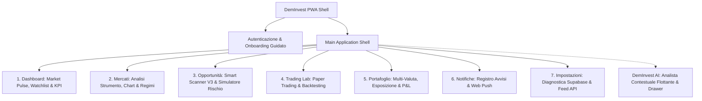

# DEMINVEST — UX ARCHITECTURE & USABILITY AUDIT REPORT
## Valutazione dell'Esperienza Utente, Progressive Disclosure e Piano di Miglioramento
**Versione:** 1.0 (Fase 4 Release)  
**Applicazione:** DemInvest — Personal Investment Intelligence PWA

---

## 1. MAPPA DELL'ARCHITETTURA DELL'INFORMAZIONE

L'architettura di DemInvest è progettata secondo il principio del **basso carico cognitivo** e dell'**orientamento immediato**:

---

## 2. MATRICE DELLA PROGRESSIVE DISCLOSURE: SEMPLICE VS PRO

DemInvest non è divisa in due applicazioni separate, ma offre **due livelli di profondità analitica dello stesso patrimonio informativo**, con persistenza immediata delle preferenze dell'utente.

| Area Applicativa | Modalità Semplice (Guidata & Rassicurante) | Modalità PRO (Approfondita & Quantitativa) |
| :--- | :--- | :--- |
| **Dashboard** | Card visive compatte della Watchlist con variazioni percentuali evidenti, market pulse sintetico e suggerimenti pratici ("Cosa fare oggi"). | Tabella ad alta densità con codici MIC, provider feed, latenza, timestamp UTC e log di utilizzo budget cron scheduler. |
| **Mercati & Asset Detail** | Spiegazione testuale chiara del trend, livello di rischio sintetico, interpretazione intuitiva di RSI e target grafici evidenti. | Matrice di coerenza Multi-Timeframe (Consensus State), valori puntuali EMA 20/50, SMA 50/100/200, ADX +DI/-DI, Momentum e pivot confermati. |
| **Opportunità & Screener** | Classifica semplificata delle migliori opportunità con motivazione in italiano, chip di filtro veloci e simulatore di size con semaforo di rischio. | Matrice multi-fattore completa, coefficiente di collinearità tra asset correlati, log degli strumenti esclusi con motivo analitico (Fail-Safe DQ). |
| **Portafoglio** | Valore complessivo, profitto/perdita non realizzato, grafico a torta intuitivo di allocazione e spiegazione dell'esposizione valutaria. | Analisi dettagliata conversioni BCE Frankfurter, impatto commissioni roundtrip, indice di concentrazione e calcolo Value-at-Risk. |
| **Trading Lab** | Simulazione paper rapida (Compra/Vendi) con calcolo automatico dei costi medi e diario emotivo/disciplinare. | Configurazione avanzata parametri di backtest (spread, slippage, commissioni, drawdown massimo), curva equity dettagliata e log trade. |

---

## 3. AUDIT DEI MIGLIORAMENTI DI USABILITÀ IMPLEMENTATI NELLA FASE 4

1. **Risoluzione dell'Attrito di Accesso (Login vs Registrazione):**  
   - *Problema precedente:* L'utente con account registrato veniva reindirizzato all'onboarding forzato.  
   - *Soluzione Fase 4:* Introdotto il selettore immediato `Accedi` vs `Registrati` con auto-rilevamento dell'account esistente e persistenza della sessione su `localStorage` e Supabase.
2. **Navigazione Ergonomica Mobile:**  
   - *Problema precedente:* Solo una barra superiore a scorrimento orizzontale, scomoda per l'uso a una mano su smartphone.  
   - *Soluzione Fase 4:* Implementata una **Bottom Navigation Bar** fissa a fondo schermo con i 5 percorsi primari e un Floating Action Button (FAB) per attivare l'AI ovunque con il pollice.
3. **Cifre e Dati Numerici a Larghezza Fissa (`.num-mono`):**  
   - *Problema precedente:* I numeri oscillavano leggermente di larghezza durante gli aggiornamenti, creando instabilità visiva.  
   - *Soluzione Fase 4:* Adozione sistematica del font numerico tabellare (`tabular-nums`) per prezzi, percentuali, coordinate di stop e target.
4. **Distinzione Semantica tra Segnali di Uscita e Segnali Short:**  
   - *Problema precedente:* Rischio di confondere un segnale ribassista generico con l'ordine di chiusura di una posizione in portafoglio.  
   - *Soluzione Fase 4:* Creazione di badge espliciti: `Uscita Posizione Esistente` (`EXISTING_POSITION_EXIT`) vs `Segnale Tecnico Ribassista di Mercato` (`BEARISH_MARKET_SIGNAL`).
5. **Comprensione Immediata dei Termini Finanziari:**  
   - *Problema precedente:* Acronimi tecnici (ADX, ATR, MIC, R/R, Spread, Slippage) non spiegati.  
   - *Soluzione Fase 4:* Aggiunti i componenti `Tooltip` contestuali che offrono una definizione pratica e non accademica con un solo tocco.
6. **Accessibilità da Tastiera e Supporto Screen Reader:**  
   - *Problema precedente:* Elementi cliccabili privi di anelli di focus evidenti.  
   - *Soluzione Fase 4:* Utility `.focus-ring` (anello verde smeraldo ad alto contrasto conforme a WCAG 2.1 AA) e chiusura modali con tasto `Escape`.

---

## 4. PIANO DI OTTIMIZZAZIONE CONTINUA (ROADMAP POST-RELEASE)

- **Personalizzazione Grafica Indicatori:** Possibilità per gli utenti PRO di personalizzare i colori delle linee EMA e Bollinger sul grafico Lightweight Charts.
- **Micro-Animazioni Transizionali:** Aggiunta di transizioni fluide tra le schede asset per un'esperienza ancora più nativa.
- **Widget PWA Offline:** Visualizzazione dello snapshot cache della watchlist anche in caso di totale assenza di rete con etichetta di congelamento dati.
